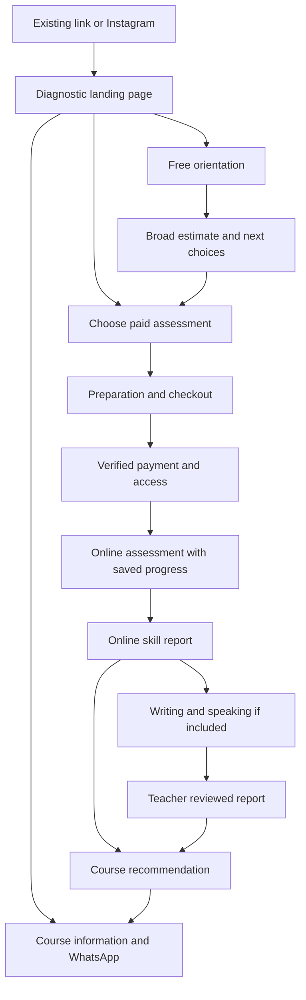

# English diagnostic website project plan

Prepared for Нұрқанат Дайраш on 21 October 2026, Asia/Qyzylorda.

This is the implementation and assessment-development plan for the experience currently reached at https://nurkanat-tau.github.io/test.html. Its purpose is to help a learner understand their English, receive a useful next-step recommendation, and choose an appropriate general-English course. The intended final range is A1–C1, with finer placement only where evidence supports it.

Status: planning only. Prices, policies, timing targets, audience assumptions, infrastructure, and draft wording below are proposals unless explicitly identified as existing information or user requirements. This plan does not authorize purchases or claim that a new site has been implemented, assessed, or deployed.

## 1. Product decisions that govern the work

Build a trustworthy diagnostic service around an understandable personal report. The report is the central product; the website explains it, delivers it, and connects it to teaching.

The user requirements are:

- Replace the current visual design completely.
- Aim to identify a learner's position within A1, A2, B1, B2, and C1.
- Keep automatable sections online; the teacher assesses speaking and writing.
- Make courses and WhatsApp contact visible before and after the assessment.
- Present a standard course of approximately six months per level and an intensive course of approximately three months per level.
- Explore paid diagnostics at 1,000 ₸ and 5,000 ₸.
- Explore bank payment/QR integration.
- Keep the separate personal/About experience connected to this diagnostic.
- Consider an original bank of around 500 questions.

Recommended product rules:

1. Show price, scope, and delivery timing before a learner starts a paid assessment.
2. Return a useful report before presenting the course recommendation.
3. Keep assessment scoring independent of class availability and sales targets.
4. Report missing evidence and uncertain boundaries honestly.
5. Treat fine subdivisions as internal placement categories, not official additional CEFR levels.
6. Preserve paid access and submitted answers through interruptions and releases.
7. Use teacher evaluation to strengthen the service and inform validation.
8. Prioritize the phone experience, including the Instagram browser and payment-app return journey.

The initial audience assumption is Russian- and Kazakh-speaking older teenagers/adults learning general English in Kazakhstan. The intended age range must be established before the bank is finalized. Children would require a different content and delivery design.

## 2. What the current source actually contains

Inspected repository: [Nurkanat-Tau/Nurkanat-Tau.github.io](https://github.com/Nurkanat-Tau/Nurkanat-Tau.github.io).

Inspected test source: [test.html](https://github.com/Nurkanat-Tau/Nurkanat-Tau.github.io/blob/main/test.html), blob SHA `a4452f21738acfb8bc8330984a5a5fa7fde6b9d0`.

Inspected home source: [index.html](https://github.com/Nurkanat-Tau/Nurkanat-Tau.github.io/blob/main/index.html), blob SHA `224f409368ca6a48ff5d2eba46cf4c4c1f5b534b`.

| Existing element | Implication for the rebuild |
| --- | --- |
| 40 questions, ten each at labelled A1–B2 | No C1 coverage; a much broader reviewed bank is needed |
| 20 grammar, 12 vocabulary, eight reading questions | Very limited evidence for detailed skill and within-level claims |
| No listening assessment | Add original audio, tasks, playback rules, and technical recovery |
| Four speaking self-assessment statements | Useful background only; they cannot substitute for observed speaking |
| Fixed ascending blocks with early termination | This is not a calibrated item-by-item adaptive test |
| Hard-coded percentage cutoffs and subdivisions inferred from the next band's score | Replace with documented rules, pilot evidence, and uncertainty handling |
| Speaking self-report can lower the suggested course group | Replace with teacher evidence and a separate course recommendation |
| Answers and scoring included in the page's JavaScript | A paid assessment needs server-side keys, grading, and access control |
| Answer selection advances after about 210 milliseconds | Add explicit submission so accidental taps can be corrected |
| Attempt responses held in memory | Add durable save/resume and paid-access recovery |
| Dark brown/gold styling | Replace with the proposed lighter visual system |
| 18-week course, September starts, reservation payments and older prices | Reconcile with the new offer; do not reuse dates or promises automatically |

The existing source already provides:

- WhatsApp: https://wa.me/77085501378.
- Main site/About section: https://nurkanat-tau.github.io/#about.
- A Kaspi QR image and payment link with manual receipt submission.
- Teacher name, portrait/video assets, and other personal-page material to review for reuse.

These are existing values to verify for the launch. Their presence does not establish current merchant API access, current pricing, availability, or evidence for every public claim.

Local folder `D:/OneDrive/Desktop/nurkanat-site` contains staged and unstaged user changes and untracked assets. Future implementation must not reset or overwrite them. Inspect and reconcile the local material against the canonical remote; use a separate checkout/branch for the rebuild. Do not assume the local README describes the current deployed product.

Audit limitation: GitHub source was readable. The live-page fetch and browser automation did not render the site in this session, so this is a source audit rather than a completed visual or functional audit. Capture baseline desktop/mobile screenshots and run the existing flow when browser tooling is available.

## 3. Preserve the entry link while choosing suitable hosting

GitHub Pages explicitly excludes sites primarily used to run an online business, facilitate commercial transactions, or provide commercial SaaS. Moving only the payment API elsewhere would not resolve a paid storefront hosted on Pages. [GitHub Pages limits](https://docs.github.com/en/pages/getting-started-with-github-pages/github-pages-limits).

Plan:

1. Keep source control in GitHub.
2. Build and review the new diagnostic on a separate staging URL.
3. Put the paid application, checkout, private results, and teacher tools on suitable commercial hosting.
4. Choose a new canonical address after the brand and hosting are decided.
5. Investigate retaining a minimal relocation notice/link at the existing `/test.html`, subject to the host's policy; do not promise permanent commercial redirection without checking.
6. Update the Instagram bio, main-site test links, and new shares to the canonical address at launch.
7. Preserve approved campaign parameters while dropping unnecessary tracking identifiers.

An HTML relocation page is different from a server-managed HTTP 301. The browser address cannot remain `github.io/test.html` while we claim the paid application is hosted elsewhere. The objective is continuity for people who already have the link, not an unsupported promise about the old host.

The separate About page is outside the redesign scope except for necessary link and offer consistency changes. Its dated claims should be listed for correction; a full personal-page redesign remains a separate project.

## 4. Offer and pricing hypothesis

| Offer | Deliverable | Proposed price | Launch condition |
| --- | --- | --- | --- |
| Quick orientation | Brief broad estimate with limited coverage stated clearly | Free | Reviewed short form and honest scope |
| Online diagnostic | Grammar/vocabulary, reading and listening profile, priorities, saved report | 1,000 ₸ | Evidence supports the reported placement claims |
| Complete diagnostic | Online work, teacher-assessed writing, speaking conversation, final study/course recommendation | 5,000 ₸ total | Teacher workflow, capacity, and review turnaround agreed |

Start by piloting the teacher-assisted complete service. It can provide useful human feedback while the automated component is being evaluated. Participants must understand that the instrument is being developed. Do not sell unvalidated precision as an established capability.

If an upgrade is offered, a learner who already paid 1,000 ₸ would pay 4,000 ₸ more to reach the proposed 5,000 ₸ total. This is a proposed commercial rule, not an existing entitlement. Likewise, crediting the diagnostic toward a course is an option to decide, not a benefit to advertise prematurely.

Before choosing the final price, estimate payment fees, teacher minutes, support time, reassessment/refund burden, hosting, and paid acquisition costs. Calculate contribution per assessment and teacher capacity. A low price is not useful if delivery consumes unsustainable teacher time.

Define attempt count, retakes, upgrade validity, access duration, rescheduling, cancellations, refunds, and the handling of incomplete teacher assessment. Show the relevant rules in plain language near purchase.

If the goal is maximum course inquiries, test whether the free entry helps. If the goal is a premium independent diagnostic, allow direct purchase. Do not force every visitor through the free test.

## 5. Design direction

The proposed visual concept is a carefully designed personal English report: clear, calm, contemporary, and human. Visitors should immediately see what they will receive and why it is useful.

Draft core message:

> Узнайте свой уровень английского.
> Поймите, что учить дальше.

Supporting draft:

> Диагностика A1–C1: профиль навыков, понятный разбор и рекомендации для следующего шага.

Final wording must reflect the actual launched coverage and validated claims. Teacher involvement must be explicit for the complete offer.

### Visual system

| Token | Proposed treatment |
| --- | --- |
| Main background | Warm ivory `#F6F5F1` |
| Main text | Ink navy `#18233D` |
| Primary action | Cobalt `#3458D4` |
| Decorative accent | Muted coral `#F3A58A`, sparingly used |
| Question/report surface | White with subtle neutral borders |
| Typography | Locally hosted, licensed sans-serif with verified Russian/Kazakh glyphs; Noto Sans is a candidate |
| Landing title | Approximately 56–68 px desktop and 36–42 px mobile, fluid and tested with actual text |
| Body and answers | Approximately 17–18 px; at least 16 px for form controls |
| Controls | Approximately 48–56 px high, comfortably spaced |
| Layout width | Around 1,160 px marketing; 680–760 px for the focused question frame |
| Spacing | Consistent 4/8-pixel-based spacing scale with generous section separation |
| Motion | Brief functional transitions and a reduced-motion variant |

Verify actual contrast rather than assuming the palette is accessible. Define hover, focus, pressed, selected, disabled, loading, success, warning, and error treatments. Error messages must tell the learner how to proceed.

Hero composition: headline and short explanation on one side, a real HTML sample report on the other. Label it `Пример результата`. On mobile, stack them with the primary action visible early. Use a horizontal level/skill display with accompanying text rather than a decorative radar chart or unsupported precise percentages.

A real teacher portrait provides the human connection. Reuse approved source assets only when they suit the new composition and are appropriate to publish. Avoid autoplay hero video, fake certification badges, manufactured testimonials, and generic stock classroom imagery that adds no information.

### How design will be evaluated

- Can a new visitor explain the service, price, and next action after a brief look?
- Can they distinguish an online estimate from the complete teacher assessment?
- Does the page show an appealing concrete deliverable?
- Is the main action obvious on a small phone?
- Is every block doing a distinct job rather than repeating the pitch?
- Can a keyboard or screen-reader user complete the journey?
- Does the visual system stay consistent through checkout failures and result recovery?
- Does the teacher identity feel credible without unsupported prestige claims?

Create two low-cost visual directions for comparison, then select one and build a component system. Do not fully implement multiple competing designs. Review with prospective learners, not just the site owner.

## 6. Landing page structure and copy

1. **Header:** teacher/course identity; links to how it works, sample report, pricing, and About; language switch; quiet WhatsApp access.
2. **Hero:** benefit-led headline; concise scope; primary `Выбрать диагностику` action; secondary `Посмотреть пример результата`; visible entry pricing once approved.
3. **Recognizable situation:** understanding texts but struggling to speak; studying for years without knowing what to work on. Avoid making the visitor feel deficient.
4. **Sample report:** show a skill profile, one strength, one improvement area, and the next step. Clearly distinguish illustration from a real student record.
5. **Method:** explain online tasks, adjustable difficulty, teacher sections, and how results are used. Link to a short methodology page.
6. **Offer comparison:** scope, price, duration target, teacher involvement, and when each report becomes available.
7. **Teacher introduction:** real name and portrait, brief verified evidence, link to `/#about` or its future destination.
8. **Course section:** standard and intensive formats, with WhatsApp registration available without taking the test.
9. **FAQ:** accuracy limits, audio, mobile use, interruptions, payment, writing/speaking, and whether a course is required.
10. **Closing action and footer:** repeat the primary action; contact, merchant details, support, privacy, and terms appropriate to the actual service.

Draft course headline: `Ваш следующий шаг — английский в подходящей группе.`

Draft course buttons: `Обсудить стандартный курс` and `Обсудить интенсив`.

The six- and three-month statements describe program duration. They are not guarantees that every learner will gain one whole CEFR level. Lesson frequency, independent study, starting point, attendance, and actual curriculum must be specified before making progress claims.

The first view has one dominant action. Courses remain prominent further down and in results, with contact accessible before the test. During assessment, remove promotional interruptions.

## 7. Full user journey and screen inventory

Required screen/state inventory:

- Landing and pricing comparison.
- Sample report.
- Free orientation introduction and broad result.
- Paid preparation, audio check, and order review.
- Checkout opening, pending, success, canceled, declined, expired, delayed/unknown, already-paid recovery.
- Practice task.
- Grammar/vocabulary item.
- Reading passage and related questions.
- Listening setup, player, loading, playback failure, and retry.
- Saving, saved, offline, reconnecting, session recovery, and duplicate-tab conflict.
- Section boundary and resume point.
- Online result: adequate evidence, uncertain boundary, below floor, upper ceiling, incomplete section.
- Writing instructions, autosaved draft, submission confirmation, awaiting review.
- Speaking request/booking, confirmation, reschedule, completed assessment.
- Final teacher report.
- Course format selection and user-initiated WhatsApp handoff.
- Private teacher dashboard, marking form, and report publication.
- Support, attempt recovery, and refund/reassessment status where applicable.

Use consistent names for these states in designs, code, tests, and support instructions.

## 8. Assessment blueprint and the 500-item bank

The test is for general-English placement and learning advice. It is not an official IELTS examination, certification, or admissions instrument. Do not convert its results into IELTS bands without independent evidence.

CEFR alignment should inform the content specification, tasks, marking, standard setting, and validation. The Council of Europe's test-development guidance applies these principles to providers ranging from individual teachers to larger institutions. [Council of Europe test-development guidance](https://www.coe.int/en/web/common-european-framework-reference-languages/developing-tests-examining).

Proposed eventual inventory:

| Intended level | Grammar in context | Vocabulary in context | Reading items | Listening items | Total |
| --- | ---: | ---: | ---: | ---: | ---: |
| A1 | 25 | 20 | 30 | 25 | 100 |
| A2 | 25 | 20 | 30 | 25 | 100 |
| B1 | 25 | 20 | 30 | 25 | 100 |
| B2 | 25 | 20 | 30 | 25 | 100 |
| C1 | 25 | 20 | 30 | 25 | 100 |
| Total | 125 | 100 | 150 | 125 | 500 |

These are planning allocations. Rebalance after reviewing skill coverage and pilot exposure. Reading/listening items are scored questions, not 275 separate passages or recordings. Keep related items together and account for their dependence in analysis.

Create writing and speaking task sets separately, initially around four sets for each intended level. Do not count them toward the 500 online items to make the bank appear larger.

Begin with a smaller reviewed core, approximately 120–180 candidate items for piloting, subject to complete route coverage. Draft and review in batches. Do not release all 500 simply because they have been generated.

### Content coverage

| Area | Lower-range examples | Upper-range examples |
| --- | --- | --- |
| Grammar | Basic statements/questions, time, quantity, everyday modality | Relationships in time, stance, qualification, clauses and discourse |
| Vocabulary | Common meanings, everyday combinations, practical contexts | Register, collocation, precision, contextual meaning |
| Reading | Signs, notices, messages, everyday instructions | Arguments, inference, cohesion, author stance and qualification |
| Listening | Short exchanges, instructions, details | Extended explanations, attitude, implied meaning, competing viewpoints |

Use accessible contexts across everyday life, work, study, travel, and services. Avoid specialist knowledge, trick wording, and cultural trivia. More obscure vocabulary does not automatically make a valid C1 question.

Each item record needs ID/version, intended skill/subskill, level rationale, stimulus, answer, acceptable variants, explanation, distractor rationales, passage/audio references, original authorship or license, reviewers, pilot exposure, statistics, and revision history.

Lifecycle: draft → independently reviewed → piloted → analysed → approved → monitored → revised or retired. Changes to published items create new versions.

### Illustrative original question drafts

These examples show the intended style. Their level labels are authoring targets, not calibrated difficulty estimates.

**A1-target grammar**

This is Mira. ___ a student.

A. She's · B. Her · C. She · D. Hers

Key: A. Measures a narrow form, not a full level.

**A2-target reading**

Saturday's class has moved from Room 4 to Room 7. The starting time is unchanged. Bring your notebook; we will supply the worksheets.

What must students bring?

A. Printed worksheets · B. A notebook · C. A room key

Key: B. Review whether the task actually discriminates at the intended boundary.

**B1-target grammar**

I moved here in 2022, and I still live here. I ___ here since 2022.

A. lived · B. am living · C. have lived · D. had lived

Key: C. Review natural alternatives and accepted variants before use.

**B2-target listening**

Authoring transcript: “I expected the online course to feel impersonal. The recorded lessons did, a little, but the small-group discussions made a real difference.”

What improved the speaker's experience?

A. Shorter recorded lessons · B. Interaction with other learners · C. A lower course price

Key: B. Learners hear reviewed audio rather than seeing this transcript. The final level depends on the complete task and trial evidence.

**C1-target reading inference**

The committee welcomed the proposal's ambition while withholding its endorsement until the projected savings could be independently verified.

What best describes the committee's position?

A. It has approved the proposal without conditions.
B. It believes the savings have already been disproved.
C. It is interested but wants evidence before committing.

Key: C. This short example alone may be too easy for C1; pilot evidence governs the final label.

Question review must consider dialect alternatives, ambiguous keys, option clues, reading burden unrelated to the construct, and duplicated content. Give correct-answer explanations after appropriate completion/review without exposing the entire protected bank.

## 9. Routing, scoring, and uncertainty

Launch with preassembled, reviewed blocks and transparent multistage routing. Move to item-by-item adaptive testing after calibration and simulations justify it.

Proposed flow:

1. Instructions and unscored practice.
2. Short routing tasks.
3. Appropriate difficulty block for each relevant domain.
4. Boundary tasks where more evidence is needed.
5. Completion once minimum coverage is met, or a defined maximum is reached.

Reading and listening need their own evidence and routing; grammar performance must not determine every other skill's difficulty. A brief self-report may inform context but cannot determine the score.

Initial online target: approximately 40–60 minutes and 45–70 scored responses. Validate both with real users. Extended reading/listening may require adjusting the range; the interface must display the actual implemented expectations.

Do not map equal percentage ranges to CEFR levels. Different forms differ in difficulty. Use anchor tasks, controlled forms, expert standard setting, pilot comparison, and later appropriate calibrated scoring.

Cambridge's adaptive assessment provides an architectural example of selecting difficulty and applying stopping rules, not evidence that our own test is valid. Its current product range also must not be confused with this project's A1–C1 scope. [Cambridge adaptive-testing paper](https://www.cambridgeenglish.org/Images/730808-linguaskill-adaptive-testing.pdf).

Reporting rules:

- Report each assessed domain separately.
- Present a provisional overall placement only when a defined, supported rule permits it; do not average CEFR letters numerically.
- Keep grammar/vocabulary supporting profiles distinct from full communicative skills.
- Mark unassessed speaking/writing as pending, not zero.
- If listening fails technically, recover or mark it incomplete rather than inferring ability.
- Use a range near uncertain boundaries, such as `A2–B1: требуется уточнение`.
- For below-floor performance, use supportive wording and offer a foundations pathway.
- At the upper ceiling, state only what the test supports; do not extrapolate to C2.
- Avoid invented confidence percentages or decimal CEFR scores.
- Treat speed and unusual patterns as possible review signals, not proof of cheating or grounds for automatic score reduction.
- Enable beginning/middle/upper subdivisions only when repeatability and placement usefulness are demonstrated.

An adaptive stopping rule eventually needs both adequate measurement precision and adequate content coverage. If the maximum is reached without enough evidence, return uncertainty and the next evaluation step.

## 10. Listening, writing, and speaking delivery

Listening requires original or licensed scripts and recordings; review naturalness, pronunciation, volume, clarity, and answer cues. Maintain an audio manifest with rights and versions. Different voices and accents can be used where appropriate, without making accent familiarity the hidden target.

Set replay and pause rules before piloting and apply them consistently. Test audio before purchase/start where practical. Use no autoplay. Design slow-loading, unavailable audio, Bluetooth interruption, and app-switch recovery. Captions/transcripts during a listening task change what is assessed; provide an appropriate alternative pathway and report its scope instead of pretending the scores are equivalent.

Writing target: 25–35 minutes, usually two tasks, with an accessible task and a more demanding task. A low online estimate should not prevent the learner from demonstrating stronger productive skills. Grade task fulfilment, coherence, linguistic range, and control using reviewed CEFR-linked descriptors.

Speaking target: 15–20 minutes, including familiar interaction, description/narrative, genuine discussion, and follow-up around the apparent boundary. Grade intelligibility, fluency, range, control, and interaction. Do not equate a native-like accent with proficiency.

Writing and speaking remain teacher-assessed in the initial product. Technology may assist organization, but no automatic AI mark substitutes for the promised teacher judgement.

Create benchmark responses, rater guidance, and moderation procedures. Double-mark an initial set and a continuing sample with an independent qualified assessor where possible. Record disagreements and changes. One teacher's judgement is useful evidence, not an error-free reference standard. [CEFR assessment resources](https://www.coe.int/en/web/common-european-framework-reference-languages/assessment).

Teacher workflow: paid learner → online completion → writing submission/speaking arrangement → rubric marking → review → published final report. Agree response times, appointment capacity, no-show policy, and rescheduling before selling this service.

## 11. Validation programme and launch gates

Separate software testing from assessment validation. Passing technical tests does not establish the accuracy of level classifications.

| Stage | Proposed work | Evidence needed before advancing |
| --- | --- | --- |
| Specification | Define purpose, audience, constructs, tasks, and reporting | Approved blueprint and scoring rationale |
| Expert review | Independent language/assessment review of bank and rubrics | Ambiguities resolved; intended coverage documented |
| Cognitive/usability trial | Approximately 12–20 learners across the intended range | Instructions understood; technical and task-design issues identified |
| Initial pilot | Approximately 100–200 diverse learners using a smaller bank | Item analysis and comparisons; sufficient exposure for limited claims |
| Expanded calibration | Recruit according to model, skill, and boundary needs | Adequate item exposure and model/decision precision |
| Holdout evaluation | Evaluate revised scoring on new learners | No tuning to the evaluation sample; uncertainty quantified |
| Ongoing review | Disputes, teacher changes, class fit, repeatability | Evidence that the system remains useful and fair |

Participant figures are operational starting points, not claims of psychometric sufficiency. A small pilot cannot validate 500 items and fifteen fine placements automatically. For illustration only, 500 items × 200 responses per item = 100,000 item responses, or 2,000 tests at 50 responses each under perfectly balanced exposure. Two hundred responses per item is not itself a guarantee or mandatory calibration threshold.

For validation, raters assess learners without seeing the automated placement first, then compare outcomes. This reduces confirmation bias; keep the validation comparison distinct from the normal teacher workflow in which the online profile may guide a follow-up conversation.

Analyse item difficulty, discrimination, distractors, missingness, passage dependencies, alternate-form stability, classification around boundaries, language/device subgroups, and teacher agreement. Predefine acceptance criteria with an assessment specialist before final evaluation. No universal accuracy percentage should be invented for marketing.

Release gates:

- Prototype: reviewed examples and a coherent complete journey.
- Teacher-assisted pilot: provisional nature disclosed; teacher completes final assessment; no unresolved critical delivery issue.
- Paid online product: credible evidence for the broad placement claims, stable scoring, support and reassessment process.
- Fine subdivisions: evidence supports each subdivision's stability and usefulness.
- Calibrated adaptive engine: sufficient calibrated bank, content constraints, exposure controls, stopping simulations, independent evaluation.

Do not lower the evidentiary gate to fit a launch date. Narrow the advertised scope when evidence is insufficient.

## 12. Result report and course recommendation

The immediate report should explain what was assessed and what the learner can do, then identify two or three priorities.

Example structure:

1. `Результат онлайн-диагностики` and a supported level/range.
2. Plain-language interpretation.
3. Reading, listening, and language-use profile, each with supporting statements.
4. Strengths and priorities tied to enough observed evidence.
5. Writing/speaking status and next steps if purchased.
6. Suggested course group, with teacher confirmation where needed.
7. Standard/intensive comparison and WhatsApp action.
8. Save/download options and a separate optional sharing action.

Do not call an online partial result a final four-skill result. The final report adds teacher assessments, relevant feedback, the recommended group, and the assessment date/version.

Draft CTA: `Обсудить подходящую группу в WhatsApp`.

Draft message, opened for the learner to send voluntarily:

> Здравствуйте, Нұрқанат! Я прошёл(ла) диагностику. Мой ориентировочный результат — A2. Интересует стандартный курс. Хочу обсудить подходящую группу.

Include only a learner-approved summary or reference. Do not place private writing, detailed answers, session tokens, or payment data in the WhatsApp URL.

If no suitable course exists, say so and offer a useful alternative discussion. Course availability must never lower or raise an assessment result. Use real group details rather than invented scarcity.

## 13. Payments and recovery

The existing site uses Kaspi links; Halyk ePay merchant access is unconfirmed. First identify the actual provider/account and supported merchant integration. Do not ask for secrets in chat or commit them to GitHub.

Halyk ePay documents checkout, invoice links, dynamic QR and transaction-status checks. Availability depends on the merchant terminal and enabled features. [ePay documentation](https://epayment.kz/docs).

Recommended first integration: hosted checkout using the enabled provider, with QR added if available. A static QR and receipt screenshot can support a clearly manual pilot but cannot promise immediate automatic entitlement.

Flow:

1. Server records the selected product and immutable price in KZT.
2. Create an order and unique payment attempt/invoice.
3. Request the provider checkout from the backend.
4. Learner pays on the provider interface.
5. Callback/return triggers verification against the provider.
6. Check invoice, amount, currency, merchant/terminal, and successful final status.
7. Grant the purchased access exactly once.
8. Store a recoverable status and payment reference.

Never treat a success URL, client-submitted amount, screenshot, or unverified callback body as proof of payment. In ePay, a successful status query is different from a captured transaction; its status API distinguishes `CHARGE` from an authorization hold. [ePay transaction status](https://epayment.kz/docs/check-status-payment).

Use application-level duplicate protection and database transactions. Do not assume a provider idempotency header exists. Reconcile an unknown payment outcome before creating another chargeable attempt.

Dynamic ePay QR is documented to expire after 20 minutes and must be enabled for the terminal. Match the implementation to documented terminal/status behavior. [ePay QR API](https://epayment.kz/docs/qr-by-api).

Required recovery cases: expired QR, app return lost, browser closed after payment, delayed confirmation, duplicate callback, two open tabs, failed status service, and refunded order. Display `Проверяем оплату. Не оплачивайте повторно.` only when the system is actually reconciling a pending outcome, with a working recovery/support route.

Store provider references and transaction metadata; let the payment provider handle card entry. Keep service policies, merchant identity, receipts, and refund handling consistent with the selected provider and applicable obligations.

## 14. Application architecture and data

Recommended initial architecture: one maintainable full-stack web application, relational database, private media/object storage where needed, and a small background reconciliation process. TypeScript and PostgreSQL are reasonable candidates; select concrete hosting/runtime after account, cost, data-location, and deployment requirements are established.

Avoid microservices and unnecessary AI dependencies. Keep the application source in GitHub; keep the protected bank, answer keys, payment secrets, and learner records out of public repositories and frontend bundles.

Logical modules:

- Public content and localization.
- Product catalogue and orders.
- Payment integration and reconciliation.
- Access/session recovery.
- Question delivery, answer saving, routing, and grading.
- Versioned reports.
- Teacher marking and publication.
- Course configuration and user-initiated contact.
- Operational metrics and error monitoring.

Data entities: learner/recovery identity, consent choices, order, payment attempt, entitlement, assessment attempt, response, item version, stimulus version, blueprint/scoring version, report version, writing submission, speaking appointment, teacher evaluation, course offering, and audit event.

Keep three lifecycles distinct:

| Payment | Assessment | Teacher service |
| --- | --- | --- |
| Created, pending, paid, failed, expired, refunded | Not started, active, saved, submitted, scored | Not included, awaiting work, scheduled, awaiting review, published |

Use opaque secure sessions and a verified recovery method for paid attempts. Decide the recovery channel with the owner. A browser-only save is insufficient for paid access. Never expose private reports through predictable IDs or public indexing.

Pin attempts to content/scoring versions. Editing a question must not change an active student's paper. Preserve historical results; define any reassessment process explicitly.

Teacher dashboard priorities: payment/access status, unfinished assessments, writing queue, speaking schedule, rubric marking, report drafts, publication history, and course follow-up status. Require proper authorization on every endpoint and strong administrator authentication.

Collect only data needed for the service. Keep marketing permission separate. Do not send raw writing, phone numbers, detailed results, or payment payloads to general analytics. Confirm applicable privacy, retention, data-location, minor-learner, and receipt requirements before choosing production infrastructure; do not assume a particular host is automatically suitable.

## 15. Accessibility, performance, and device quality

Target WCAG 2.2 AA where applicable: clear labels, keyboard operation, visible focus, semantic controls, error explanations, appropriate contrast, zoom/reflow, reduced motion, and accessible status messages. Assessment accommodations must preserve or explicitly qualify the measured construct. [W3C WCAG quick reference](https://www.w3.org/WAI/WCAG22/quickref/).

Suggested phone checks: 360, 390, and 430 px widths, larger text, small viewport height, landscape where needed, and screen zoom. Test actual supported browsers/devices rather than relying solely on screenshots.

Performance targets: field 75th-percentile LCP at most 2.5 seconds, INP at most 200 ms, CLS at most 0.1. Lab checks help before launch; they do not prove field results. [Google Web Vitals guidance](https://web.dev/articles/vitals).

Avoid autoplay media, oversized embedded images, loading the entire bank, and downloading all listening audio before it is needed. Preserve visible content while fonts/media load. Optimize real portraits and share images.

Instagram browser testing must include payment handoff, audio, external WhatsApp navigation, return after app switching, cookies/storage restrictions, and resume behavior. Provide a clear external-browser alternative if necessary without losing access.

## 16. Analytics and improvement

Measure the complete journey, with clear definitions and minimal personal data:

- Landing visits and acquisition source.
- Sample-report views and offer selections.
- Free starts/completions.
- Checkout creation, provider handoff, verified payment and failure category.
- Paid starts, section completions, abandonment and recovery.
- Report views/downloads.
- Teacher appointments, completed reviews and turnaround.
- WhatsApp clicks, qualified inquiries, confirmed enrollment and later placement changes.

A WhatsApp click is not an enrollment. A payment is not a completed assessment. Keep denominators explicit when reporting conversion.

Monitor assessment quality alongside commercial performance: teacher overrides, disputed levels, group transfers, incomplete audio, scoring-version differences, and whether learners cope in their recommended group.

First experiments: headline clarity, sample-report placement, direct purchase versus free orientation entry, offer explanation, and proposed diagnostic-to-course credit. Change one material variable at a time when traffic permits. With low traffic, combine moderated user feedback and observed funnels rather than claiming statistical certainty from tiny samples.

Do not optimize conversion by hiding price, lowering scores, fabricating urgency, or withholding already-promised results.

## 17. Implementation sequence and concrete deliverables

| Phase | Work | Deliverable | Exit condition |
| --- | --- | --- | --- |
| 0 | Confirm live source, deployment, local changes, assets and account capabilities | Baseline audit, preserved source revision, affected-file list | Existing site recoverable; scope and ownership clear |
| 1 | Set product rules, assessment purpose, provisional offers, teacher process | Product brief, decision register, blueprint | No contradictory promise in the proposed journey |
| 2 | Develop two visual sketches, select one, write real screen copy | Mobile/desktop prototype and component system | Users understand the offer, report, price and next step |
| 3 | Draft/review initial question and task bank | Versioned content, audio plan, rubrics, review log | Every pilot route has reviewed content |
| 4 | Build sessions, assessment delivery, saving, scoring and reports | Working staging diagnostic | Known response fixtures reproduce expected outcomes; recovery works |
| 5 | Add provider sandbox, orders, access and teacher queue | End-to-end sandbox service | Payment, access and teacher workflows survive failure cases |
| 6 | Conduct learner trials and independent assessment comparison | Pilot analysis and revised content/scoring | Claims match the available evidence |
| 7 | Run limited commercial pilot if appropriate | Real operational workflow with capped capacity | Support, payments, teacher turnaround and reporting work |
| 8 | Publish on appropriate hosting and migrate entry links | Production service and recovery/rollback runbook | Live smoke checks pass; paid learners remain protected |
| 9 | Expand bank and refine validated precision | Calibration releases, quality reports, measured UX improvements | Each new claim and feature has evidence and regression coverage |

Phases 2 and 3 can proceed in parallel. Infrastructure investigation can also proceed while content is reviewed. Final copy depends on product decisions; final scoring depends on pilot evidence. Build stable interfaces between these tracks rather than repeatedly rebuilding the site.

This is a staged product and assessment programme, not a one-pass HTML rewrite. The schedule should be estimated after confirming assets, merchant access, teacher availability, and pilot recruitment. Code speed cannot replace participant evidence.

During implementation, work in small reviewable changes. Record decisions, keep source control clean, use an isolated branch/checkout, and provide recognizable previews early. User approval or missing information should concern a concrete result or decision, not interrupt routine reversible work.

## 18. Verification and release checklist

Meaningful automated checks:

- Fixed-response scoring and routing fixtures for floor, ceiling, uneven skills, boundary cases, missing sections and maximum length.
- No result changes due to option shuffling or repeat submissions.
- Answer-save/retry correctness and concurrent tab behavior.
- Duplicate/out-of-order callbacks, forged status, altered amount, mismatched currency, authorization-only and delayed payment.
- One paid order grants the correct entitlement once; upgrade/refund behavior matches policy.
- Students cannot read one another's answers/results or teacher drafts.
- A report records its item, rubric and scoring versions.
- Teacher publication changes visibility only after an authorized action.

Human/browser checks:

- Landing, offer and report comprehension with prospective learners.
- Complete journeys on representative phones, desktop, and Instagram browser.
- Keyboard and screen-reader spot checks; contrast and zoom.
- Listening on slow networks and after app switching.
- Interruptions, refreshes, resume, expired checkout and support recovery.
- Actual WhatsApp message content and course details.
- RU/KZ proofreading and glyph coverage before each language is enabled.

Operational checks:

- Separate staging/live payment credentials and databases.
- No secrets or answer bank in public builds/logs.
- Backup restoration and backward-compatible migrations tested.
- Independent switches to pause new sales and new attempts.
- Rollback preserves paid entitlements, responses and published reports.
- Teacher capacity and promised turnaround are achievable.
- No outdated September dates, 18-week promises, unsupported counts, or prices carried into the new offer.

The website is complete only when the full service works for actual learners. A polished homepage alone is not completion.

## 19. Decisions needed from the owner

Ask these in small groups at the point they affect work; do not present every question as a prerequisite to making progress.

| Decision | Existing evidence/default | Needed before |
| --- | --- | --- |
| Brand/display name | Existing name: Нұрқанат Дайраш | Final identity/copy |
| WhatsApp destination | Existing link: +7 708 550 13 78 | Publishing contact actions |
| Audience and age range | Proposed older teens/adults | Final bank and privacy workflow |
| Interface languages | RU source; personal site has multilingual content | Translation and language QA |
| Merchant/payment provider | Existing Kaspi link; ePay unconfirmed | Live payment integration |
| Prices and upgrade policy | 1,000 ₸ / 5,000 ₸ are proposals | Checkout publication |
| Teacher assessment capacity and turnaround | Not yet specified | Selling complete diagnostic |
| Course frequency, workload, price, dates and levels offered | New approximate six/three-month durations | Course recommendation and registration copy |
| Course credit, refunds, retakes and cancellations | Not yet agreed | Paid service launch |
| Recovery contact method | To select | Paid access implementation |
| Hosting/domain budget and requirements | Paid app needs suitable hosting | Production deployment |
| Evidence and asset permissions | Existing assets available for review | Public claims and imagery |

These decisions do not prevent wireframes, initial content specification, source audit, prototype work, or draft question review. Until settled, keep their values as clearly labelled internal configuration/proposals, not public promises.

## 20. First implementation work package

The first concrete build should deliver a reviewable phone-first landing page, one complete sample assessment journey, and a detailed sample report, together with the assessment specification and initial reviewed item set.

It should include the primary visual system, real teacher identity, sample-result illustration, provisional offer comparison visibly labelled in staging, focused question screens, audio-check design, saved-progress states, online/teacher report distinction, course recommendation, and WhatsApp handoff.

It should use mock checkout in staging until provider access and real payment behavior are verified. Do not connect the prototype to real charges, call illustrative results validated, or replace the live site just to show design progress.

The following work package adds durable backend behavior, teacher review, sandbox payments, and pilot instrumentation. The evidence from those stages determines what can be honestly sold and how fine the reported placement can become.
